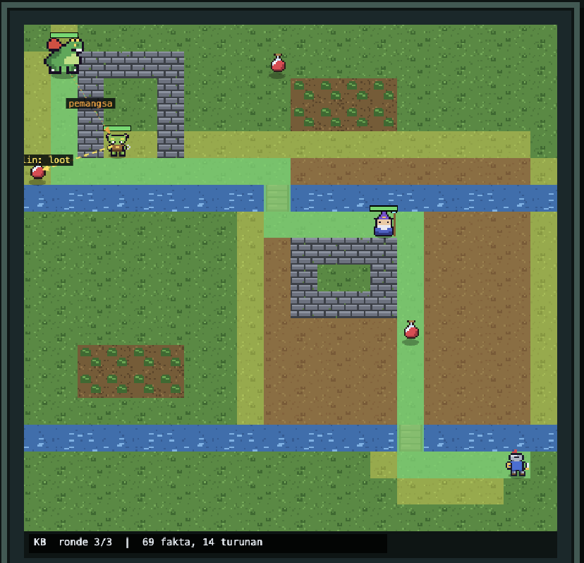
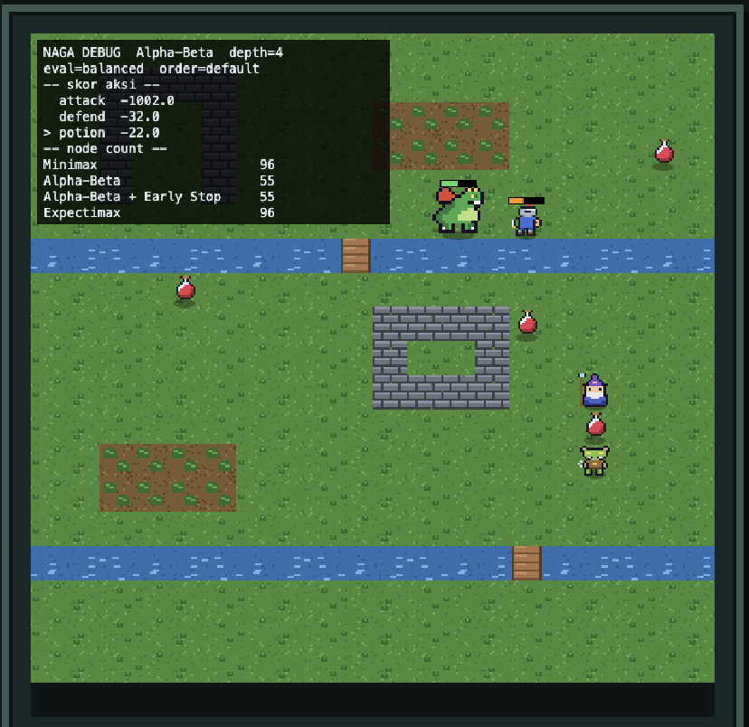

# Laporan Tugas Besar Tahap 4: Basis Pengetahuan, Logika, dan Automated Planning

**Mata Kuliah:** Kecerdasan Buatan
**Anggota Kelompok:** Kelompok 13
*(Azzam Muhammad Naufal, Salman Ghiffari, Zora Riyadhul Jinan)*

---

## Daftar Isi

1. Pendahuluan
2. Deskripsi Environment dan PEAS
3. Arsitektur Sistem dan Pemisahan Basis Pengetahuan
4. Basis Pengetahuan dan Inferensi Forward Chaining
5. Automated Planning (STRIPS)
6. Decision under Uncertainty (MEU dan MDP)
7. Eksperimen dan Analisis
8. Integrasi dalam Game
9. Kesimpulan

---

## 1. Pendahuluan

Tahap 4 berbeda secara tematik dari tahap-tahap sebelumnya, bukan secara teknis. Pada Tahap 1,
sistem yang dibangun hanya memiliki satu agen, yaitu NPC naga yang bergerak mengikuti jalur
terpendek. Pada Tahap 2 dan 3, kecerdasan agen masih bersifat lokal: satu agen, satu tujuan,
satu lingkungan yang relatif tetap. Pertanyaan yang belum terjawab adalah bagaimana beberapa
agen dalam satu lingkungan saling memahami,afsir, dan merespons perilaku satu sama lain tanpa
penulisan aturan secara manual untuk setiap kemungkinan interaksi.

Tahap 4 menjawab pertanyaan tersebut dengan menambahkan basis pengetahuan (KB) yang terpisah dari
kode permainan, inferensi logika, perencanaan otomatis, dan pengambilan keputusan dalam kondisi
tidak pasti. Tujuan yang disimpulkan dari KB dirangkai menjadi rencana aksi, dan pilihan antara
beberapa rencana yang sama-sama memenuhi tujuan diselesaikan dengan expected utility dan MDP.

Bentuk sistem yang dihasilkan adalah *Ksatria vs Naga*, permainan berbasis grid yang memadukan
seluruh materi tubes dari Tahap 1 sampai Tahap 4. Empat agen hidup bersama di satu peta: ksatria
(pemain), naga, goblin, dan penyihir. Naga keberadaannya ditentukan oleh basis pengetahuan
yang sama dengan goblin dan penyihir, sehingga perilaku ketiga agen muncul dari aturan yang
sama, bukan dari logika yang ditulis terpisah per agen.

Bagian 2 mendefinisikan environment dan PEAS agen. Bagian 3 menjelaskan arsitektur modul dan
alasan pemisahan KB dari kode. Bagian 4 sampai 6 menguraikan tiga mekanisme kecerdasan yang
diimplementasikan, yaitu inferensi logika, perencanaan otomatis, serta decision under
uncertainty. Bagian 7 menyajikan hasil eksperimen kuantitatif beserta analisisnya. Bagian 8
menjelaskan integrasi seluruh mekanisme ke dalam permainan, dan Bagian 9 menyimpulkan pekerjaan
Tahap 4.

---

## 2. Deskripsi Environment dan PEAS

### A. Peta dan Bobot Biaya

Peta direpresentasikan sebagai matriks karakter berukuran 19 x 20. Setiap sel memiliki jenis
*tile* yang menentukan apakah sel dapat dilalui dan berapa biaya untuk memasuki sel tersebut.
Tabel 1 memuat spesifikasi bobot lingkungan ini.

**Tabel 1.** Spesifikasi bobot sel pada peta.

| Tile | Arti | Biaya masuk | Dapat dilalui? |
|------|------|-----------|----------------|
| `.` | Rumput | 1 | Ya |
| `^` | Lumpur / semak | 3 | Ya |
| `=` | Jembatan kayu | 1 | Ya |
| `#` | Tembok batu | - | Tidak |
| `~` | Air | - | Tidak |

Gerak dibatasi pada empat arah, yaitu atas, bawah, kiri, dan kanan. Sebuah *state* adalah
pasangan koordinat (x, y), sedangkan *cost* jalur adalah jumlah biaya masuk seluruh sel yang
dilewati. Karena terdapat sel dengan biaya lebih besar dari satu, jarak terpendek dalam satuan
langkah tidak selalu sama dengan biaya optimal. Contohnya, jalur yang melewati lumpur
menghasilkan biaya tiga per sel, sehingga jalur yang secara geometris lebih pendek dapat
memiliki biaya total yang lebih besar.

Air dan tembok membelah peta menjadi beberapa komponen terhubung. Hal ini posing untuk
pencarian jalur dan pembuatan level, sebab agen dapatTerpisah dari tujuan secara permanen.
Karena itu, pembuatan level memakai kendala konektivitas yang eksplisit, dijelaskan pada
Bagian 8.

### B. PEAS Agen Naga

**Tabel 2.** Rincian PEAS untuk agen naga.

| Komponen | Isi |
|----------|-----|
| Performance | Menangkap ksatria secepat mungkin (posisi naga menjadi sama dengan posisi ksatria); bertahan hidup dengan HP tidak menyentuh batas bawah 5; tidak menghalangi jalur ksatria |
| Environment | Peta grid 19 x 20 dengan biaya sel bervariasi; air dan tembok sebagai halangan; ksatria yang terus bergerak; goblin dan penyihir sebagai agen lain; giliran battle yang bergantian; status umur dan lapar yang meningkat setiap giliran |
| Actuators | Bergerak empat arah mengikuti jalur hasil pencarian; menyerang ksatria dengan serangan melee (damage 25, peluang kena 80 persen); kabur dari ancaman; memberi upeti; memangsa lawan |
| Sensors | Melihat petak di sekitarnya; mengetahui posisi ksatria, goblin, dan penyihir; membaca HP sendiri dan HP lawan; mengetahui jumlah ramuan yang dibawa; mendeteksi ancaman dalam radius enam petak |

**Performance.** Ukuran kinerja agen naga diukur dari empat hal. Pertama, efektivitas, yaitu
apakah naga berhasil menangkap ksatria. Kedua, kecepatan respons, yaitu berapa banyak langkah
pencarian yang dibutuhkan untuk mencapai posisi ksatria. Ketiga, efisiensi, yaitu apakah naga
mengambil damage yang mestinya ditanggung ksatria. Keempat, kelangsungan hidup, yaitu apakah HP
naga sendiri habis. Agar keempat ukuran ini tidak saling bertentangan, satu aturan tambahan
dipakai: HP naga tidak boleh turun di bawah 5, sebab agen yang mati tidak lagi dapat pursue
dan membuat eksperimen perbandingan menjadi tidak konsisten.

**Environment.** Lingkungan naga adalah peta grid dengan biaya sel yang tidak seragam. Air dan
tembok berdiri sebagai penghalang permanen, sedangkan sungai yang disambungi jembatan kayu
memberi jalur alternatif yang menjadi mahal bila kondisi air berubah. Ksatria bergerak terus setiap giliran
sehingga posisi target ikut berubah. Dua agen lain, yaitu goblin dan penyihir, menempati peta
yang sama dan dapat menjadi musuh maupun sekutu bergantung pada fakta-fakta yang berlaku.

**Actuators.** Empat arah gerak mengikuti jalur yang dihasilkan algoritma pencarian. Naga
menyerang ksatria dengan serangan melee yang memiliki damage 25 dan peluang kena 80 persen,
Naga juga dapat kabur, memakan, atau memberi upeti sesuai aturan KB., memakan, atau memberi upeti sesuai aturan KB. Setiap giliran
battle dipilih tepat satu aksi.

**Sensors.** Persepsi naga mencakup posisi ksatria yang diperbarui setiap giliran, posisi dua
agen lain, HP miliknya sendiri, HP lawan, jumlah ramuan yang dibawa, serta status lapar yang
meningkat setiap giliran dan memicu perubahan perilaku.

### C. PEAS Agen Goblin dan Penyihir

**Tabel 3.** Ringkasan PEAS untuk agen goblin dan penyihir.

| Aspek | Goblin (pencuri) | Penyihir |
|-------|------------------|----------|
| Performance | Mencuri ramuan milik agen lain tanpa terdeteksi; kabur bila terancam | Memulihkan HP penyihir dan agen yang lemah; tetap aman dalam radius tempur |
| Environment | Peta yang sama; ksatria dan naga sebagai target interaksi | Peta yang sama; ksatria dan naga sebagai target interaksi |
| Actuators | Mencuri, kabur, memberi upeti, menyerang, memangsa | Mem-cast sihir (damage 18, peluang kena 70 persen), kabur, memberi upeti |
| Sensors | Melihat petak di sekitarnya; mengetahui siapa yang membawa ramuan | Melihat petak dalam radius tiga; mengetahui HP lawan |

Kedua agen ini memakai basis pengetahuan yang sama dengan naga. Perbedaan perilaku muncul dari
fakta statis yang berbeda, misalnya `trait(goblin, thief)` dan `trait(mage, caster)`, bukan dari
logika terpisah. Inilah bentuk umum yang diminta pada soal: satu KB, banyak agen, perilaku
beragam.

---

## 3. Arsitektur Sistem dan Pemisahan Basis Pengetahuan

### A. Struktur Modul

Implementasi dipisah menjadi modul yang masing-masing dapat diuji tanpa browser. Tabel 4
merangkum isi setiap modul.

**Tabel 4.** Daftar modul pada implementasi Tahap 4.

| Modul | Isi | Digunakan oleh |
|-------|-----|----------------|
| `main.py` | `GridMap`, `Pathfinding`, battle engine, `LevelCSP`, dan seluruh lapisan tampilan (PyScript + Canvas) | Aplikasi web |
| `kb.txt` | Basis pengetahuan: fakta statis dan aturan Horn dengan prioritas | Mesin inferensi |
| `kb_engine.py` | Parser KB, forward chaining, pelacakan jejak penurunan | `agents.py` |
| `planner.py` | STRIPS: definisi operator dan pencarian rencana | `agents.py` |
| `decision.py` | Model hasil aksi, expected utility, value iteration | `agents.py` |
| `agents.py` | `WorldSim`: persepsi, inferensi, keputusan, perencanaan, eksekusi | `agents.py` |
| `experiments_agents.py` | Eksperimen headless untuk KB, planner, dan MDP | Eksperimen |
| `experiments_battle.py` | Eksperimen headless untuk battle engine | Eksperimen |
| `experiments_search.py` | Eksperimen headless untuk pathfinding dan generator level | Eksperimen |

### B. Mengapa KB Harus Terpisah dari Kode

Persyaratan utama Tahap 4 adalah basis pengetahuan tidak boleh tertanam di dalam kode program.
Kenyataannya, file `kb.txt` berisi seluruh pengetahuan dalam bentuk deklaratif, sedangkan
`kb_engine.py` hanya berisi mekanisme generik untuk membacanya. neither engine maupun engine
yang mengimplementasikan algoritma tersebut diketahui apa pun tentang naga, goblin, atau penyihir
secara spesifik.

Konsekuensi pemisahan ini bersifat praktis, bukan sekadar estetika. Menambah perilaku baru
misalnya goblin menjadi pemburu dengan cukup menambahkan aturan baru di `kb.txt`, tanpa
menyentuh satu baris pun Python. Aturan baru tersebut langsung dapat diuji, karena eksperimen
memuat KB dari file yang sama dengan aplikasi.

### C. Aliran Inferensi per Giliran

Satu giliran dunia mengalami lima tahap yang berurutan. Pertama, persepsi: setiap agen yang
hidup menghasilkan fakta dinamis berupa `alive`, `hp_level`, status ramuan, status lapar, dan
relasi jarak terhadap agen lain. Kedua, inferensi: fakta-fakta tersebut masuk ke `kb_engine`
sebagai *facts*, lalu forward chaining menghasilkan fakta turunan seperti `enemy`,
`stronger`, `threat`, dan `act`.

Ketiga, penentuan tujuan: fakta `goal` yang disimpulkan KB diambil, dan tujuan dengan prioritas
tertinggi dipilih. Keempat, perencanaan: tujuan tersebut dipecah menjadi operator STRIPS, lalu
dicari rencana terpendek dengan UCS atau A*. Kelima, keputusan dan eksekusi: kandidat aksi
diperiksa, baik dengan prioritas aturan KB maupun dengan expected utility, lalu satu aksi
dieksekusi.

Tahap kelima memuat satu koreksi yang penting. WorldSim menjalankan plan lebih dulu, kemudian
mengeksekusi aksi. Bila aksi yang ditentukan KB tidak valid karena jarak atau kondisi, NPC
mengikuti rencana yang telah disusun, bukan berhenti. Hal ini mencegah NPC mati karena
kebuntuan saat KB menghasilkan aksi yang tidak dapat dijalankan.

### D. Overlay Inferensi

**Gambar 1.** Overlay proses inferensi KB pada canvas permainan.




Antarmuka menampilkan proses inferensi secara langsung pada canvas. Setiap ronde
forward chaining digambar sebagai lapisan info yang berbeda, accompanied ringkasan pada panel
kanan berisi jumlah fakta, jumlah fakta turunan, jumlah ronde, aturan yang terpicu, dan waktu
inferensi dalam milidetik. Ronde pertama, kedua, dan ketiga ditampilkan berurutan, sehingga
pengamat dapat melihat bahwa fakta turunan benar-benar diturunkan bertahap, bukan dihitung
sekaligus.

Overlay ini menjawab kebutuhan demonstrasi proses inferensi secara visual, sekaligus menjadi
alat verifikasi: bila jumlah ronde atau jumlah fakta turunan tidak sesuai dengan yang
diharap, segera ketahuan bahwa KB berubah perilaku.

**Gambar 1.** Peta permainan dengan overlay proses inferensi KB. Baris paling bawah canvas
menampilkan ronde inferensi yang sedang berjalan, jumlah fakta, dan jumlah fakta turunan.

---

## 4. Basis Pengetahuan dan Inferensi Forward Chaining

### A. Sintaks KB

KB ditulis dalam format deklaratif sederhana. Fakta statis ditulis sebagai
`predikat(argumen, ...)`. Aturan ditulis dengan sintaks `[ID p=prioritas] kepala :- badan1, badan2.`
Huruf kapital menandai variabel, sedangkan huruf kecil dan angka menandai konstanta.
Predikat builtin yang tersedia adalah `neq(X, Y)` yang berarti X tidak sama dengan Y. Nilai
prioritas `p` pada aturan dipakai untuk menyelesaikan konflik ketika beberapa aturan
menghasilkan aksi yang sama untuk satu agen.

**Tabel 5.** Komposisi basis pengetahuan.

| Kelompok | Jumlah | Fungsi |
|----------|--------|---------|
| Fakta statis identitas | 14 | `npc`, `species`, `faction`, `hostile`, `eats`, `power`, `outranks`, `trait` |
| Fakta statis angka | 30 | `maxhp`, `melee`, `spell`, `steal_chance`, `flee_chance`, `greed`, `caution`, `speed` |
| Aturan relasi (R1-R8) | 10 | Menurunkan `enemy`, `friend`, `predator`, `stronger`, `needs`, `threat` |
| Aturan kemampuan (C1-C3) | 3 | Menurunkan `can(steal)`, `can(gift)`, `can(devour)` |
| Aturan aksi (A1-A9) | 10 | Menurunkan `act(pelaku, aksi, sasaran)` |
| Aturan tujuan (G1-G5) | 5 | Menurunkan `goal(pelaku, jenis_tujuan, sasaran)` |
| **Total** | **28 aturan, 44 fakta statis** | |

### B. Contoh Aturan

Aturan berikut illustrates bagaimana pengetahuan dirumuskan secara deklaratif.

Aturan R1 menurunkan hubungan musuh dari faksi yang saling bermusuhan:

```
[R1] enemy(X,Y)    :- faction(X,F1), faction(Y,F2), hostile(F1,F2).
```

Aturan A5 menurunkan tindakan kabur ketika agen mengetahui adanya ancaman:

```
[A5] p=88 act(X,flee,Y)   :- threat(X,Y).
```

Aturan G4 menurunkan tujuan mengoleksi ramuan bagi goblin yang tidak membawa ramuan dan
memiliki kemampuan mencuri:

```
[G4] p=50 goal(X,loot,none)    :- can(X,steal,Y), no_potion(X).
```

Perhatikan bahwa A5 bergantung penuh pada R7, yang bergantung pada R1. Rantai dependensi inilah
yang membuat perlakuan terhadap-the goblin otomatis berubah ketika fakta faksi diubah.

### C. Forward Chaining dengan Ronde Sinkron

Mesin inferensi menjalankan *forward chaining* dalam ronde sinkron. Pada setiap ronde, semua
aturan dicocokkan terhadap fakta yang sudah ada pada awal ronde tersebut. Fakta baru yang
ditemukan pada ronde ini masuk ke fakta pada akhir ronde dan baru boleh dipakai pada ronde
berikutnya. Pendekatan ini dipilih karena dengan cara tersebut dapat dihitung dengan tepat
berapa banyak ronde yang dibutuhkan untuk mencapai closure, yaitu titik ketika tidak ada lagi
fakta baru yang dapat diturunkan.

Closure ditandai dengan fakta turunan yang ditandai `depend on kondisi saat ini`, yaitu fakta
yang diturunkan dari fakta dinamis. Penandaan ini menyimpan informasi apakah sebuah fakta
turunan tetap berlaku bila kondisi dunia berubah. Fakta `act` untuk )}
mengambil ramuan atau ,
akan kedaluwarsa ketika ramuan sudah diambil, sedangkan fakta `enemy` dan `stronger` tetap
berlaku karena berasal dari fakta statis.

### D. Resolusi Konflik dan Prioritas

Beberapa aturan dapat menghasilkan aksi yang sama untuk agen dan sasaran yang sama. Contohnya,
A7 dan A8 sama-sama menurunkan `attack` ketika agen berhadapan dengan musuh, dan A3 serta A9
sama-sama menurunkan `cast` untuk penyihir. Aturan dengan prioritas lebih tinggi menang.

**Tabel 6.** Konflik aturan pada contoh keadaan uji.

| Fakta turunan | Prioritas | Aturan|win |
|---------------|-----------|-------|-----|
| `act(goblin,flee,mage)` | 88 | A5 | Ya |
| `act(mage,flee,naga)` | 88 | A5 | Ya |
| `act(mage,cast,goblin)` | 78 | A9 | Ya |
| `act(mage,cast,naga)` | 78 | A9 | Ya |

Prioritas{A5 yang 88 mengalahkan A8 yang 75, sehingga ketika ada ancaman, agen lebih memilih
kabur daripada menyerang. Urutan prioritas membentuk hierarki perilaku yang dapat dibaca langsung
dari file KB.

### E. Jejak Penurunan

Mesin inferensi menyediakan fungsi `explain` yang menelusuri asal-usul sebuah fakta turunan
hingga ke fakta statis dan fakta dinamis. Jejak untuk `act(goblin,flee,mage)` pada keadaan uji
adalah sebagai berikut.

```
act(goblin,flee,mage)  <= A5 p=88
  threat(goblin,mage)  <= R7
    enemy(goblin,mage)  <= R1
      faction(goblin,monster)  [fakta]
      faction(mage,guild)  [fakta]
      hostile(monster,guild)  [fakta]
    stronger(mage,goblin)  <= R4
      power(mage,mid)  [fakta]
      power(goblin,low)  [fakta]
      outranks(mid,low)  [fakta]
    in_range(goblin,mage)  [fakta dinamis]
    hp_level(goblin,mid)  [fakta dinamis]
```

Jejak ini dipakai pada antarmuka untuk menjelaskan alasan keputusan NPC. Tanpa jejak
penurunan, panel hanya menampilkan aksi yang dipilih, sehingga pengamat tidak dapat membedakan
apakah keputusan berasal dari aturan yang benar atau dari bug pada pencarian aksi.

---

## 5. Automated Planning (STRIPS)

### A. Format Operator

Perencanaan memakai representasi STRIPS. Suatu operator terdiri atas empat bagian, yaitu
prasyarat `pre`, efek positif `add`, efek negatif `del`, dan biaya `cost`. Contoh operator
`move` yang dihasilkan otomatis oleh `WorldSim.build_plan` adalah sebagai berikut.

```
move(a, b)   pre: {at(me, a)}
             add: {at(me, b)}
             del: {at(me, a)}
             cost: jarak biaya lintasan dari a ke b
```

Operator `pickup` untuk ramuan ke-i adalah sebagai berikut.

```
pickup(p_i)  pre: {at(me, p_i), potion_at(p_i)}
             add: {holding(me)}
             del: {potion_at(p_i)}
             cost: 1
```

Tujuan yang diturunkan dari KB dipetakan ke sekumpulan operator sesuai jenisnya. Tabel 7
memuat pemetaan tersebut.

**Tabel 7.** Pemetaan tujuan KB ke operator STRIPS.

| Tujuan dari KB | Kondisi goal | Operator yang dibangun |
|-----------------|--------------|--------------------------|
| `loot` | `holding(me)` | `pickup(p_i)` untuk setiap ramuan, `steal(y)` bila target punya ramuan |
| `collect` | `holding(me)` | `pickup(p_i)` untuk setiap ramuan |
| `tribute` | `gifted(y)` | `give(y)` |
| `hunt` | `devoured(y)` | `devour(y)` |
| `shelter` | `at(me, hide)` | `move(a, b)` menuju petak tersembunyi |

### B. Algoritma Pencarian Rencana

Tiga algoritma tersedia, yaitu UCS tanpa heuristik, A* dengan goal-count, dan A* dengan h_max.
Fungsi h_max menghitung biaya terkecil untuk mencapai setiap atom pada problem relaksasi,
yaitu relaksasi tanpa efek negatif. Karena delete-list diabaikan, h_max bersifat admissible,
sehingga A* dengan h_max mempertahankan optimalitas.

Fungsi h_goalcount menghitung jumlah atom tujuan yang belum terpenuhi. Heuristik ini tidak
selalu admissible, sebab satu aksi dapat memenuhi beberapa atom tujuan sekaligus. Karena itu
biaya yang dihasilkan A* goal-count dapat lebih besar daripada biaya optimal, meskipun
pencariansinya tetap lebih terarah daripada UCS.

### C. Contoh Rencana dari KB

Pada keadaan uji, goblin memiliki tujuan `goal(goblin,loot,none)` yang diturunkan oleh aturan
G4. Rencana yang dihasilkan adalah `move(me,p1) -> pickup(p1)`, dengan node diekspansi
3 dan biaya 8.8. Penyihir dan naga tidak memiliki tujuan pada keadaan tersebut, karena
fakta `can(gift)`, `can(devour)`, dan `can(steal)` tidak berlaku bagi mereka.

---

## 6. Decision under Uncertainty (MEU dan MDP)

### A. Model Hasil Aksi

Setiap aksi memiliki model hasil stokastik. Untuk aksi `attack`, hasilnya berupa dua cabang,
yaitu damage sebesar 25 dengan peluang 80 persen dan tanpa damage dengan peluang 20 persen.
Bila lawan membalas, setiap cabang digabung dengan cabang balasan, sehingga jumlah cabang
mungkin menjumlah empat. Struktur peluang ini disimpan pada namedtuple `Br` yang memuat peluang,
HP pelaku setelah aksi, jumlah ramuan, HP lawan setelah aksi, ramuan lawan, bonus, penanda
balasan, dan penanda melarikan diri.

Tabel 8 memuat model hasil untuk seluruh aksi yang mungkin.

**Tabel 8.** Model hasil (outcome) per aksi.

| Aksi | Peluang dan akibat |
|------|--------------------|
| `attack` | 80 persen: theater reduce HP lawan 25; 20 persen: meleset. Bila lawan membalas, HP pelaku berkurang sesuai damage dan peluang balasan |
| `cast` | 70 persen: reduce HP lawan 18; 30 persen: meleset, dengan balasan yang sama |
| `devour` | 90 persen: korban mati, HP pelaku pulih 25, lapar terpenuhi; 10 persen: gagal menerkam |
| `steal` | 55 persen: dapat satu ramuan; 45 persen: ketahuan dan kehilangan HP 6 |
| `gift` | Pasti: Giving satu ramuan, HP lawan naik 30, lapar lawan reda |
| `drink` | Pasti: minum satu ramuan, HP naik 30 |
| `flee` | 60 sampai 75 persen tergantung agen: melarikan diri; sisanya: gagal dan tetap diserang |

### B. Expected Utility

Fungsi utilitas satu cabang bergantung pada mode yang dipilih. Pada mode `meu`, utilitas bersifat
miopik dan linear terhadap HP, dengan bobot kehati-hatian yang diambil dari fakta `caution`
agen. Untuk agen yang melihat lawan sebagai musuh, rumus utilitasnya adalah
`w_hp * 10 * hp_pelaku / maxhp - 6 * hp_lawan / maxhp_lawan`, ditambah bonus dan nilai ramuan.
Bobot `w_hp` bernilai `caution / 50`, sehingga goblin dengan `caution` 100 memiliki bobot dua,
lima kali hati-hati daripada naga dengan `caution` 40 yang berbobot 0,8.

Pada mode `mdp`, utilitas cabang diambil dari nilai `V*` hasil value iteration, bukan dari
penilaian linier. Dengan demikian, pilihanaksi memperhitungkan konsekuensi jangka panjang,
bukan hanya hasil satu langkah.

### C. MDP Pertarungan

MDPceo perturbation fighters dimodelkan dengan state berupa pasangan bucket HP pelaku dan bucket
HP lawan. HP dikelompokkan menjadi lima bucket ditambah satu state terminal untuk mereka yang
mati. State terminal tambahan adalah `WIN`, `LOSE`, dan `ESC`. Tiga aksi tersedia, yaitu `strike`,
`guard`, dan `flee`. Fungsi nilai dihitung dengan value iteration sampai perubahan maksimum
kurang dari 1e-3 atau maksimum 300 iterasi.

Parameter MDP diturunkan langsung dari fakta statis KB, sehingga tidak ada angka yang
dimasukkan manual. Damage dan peluang hit serangan diambil dari `melee` dan `spell`,
peluang kabur dari `flee_chance`, dan kerugian dari `caution`.

### D. Perbandingan Ketiga Mode Keputusan

**Tabel 9.** Karakteristik tiga mode keputusan.

| Aspek | Prioritas KB | MEU | MDP |
|-------|--------------|-----|-----|
| Dasar pilihan | Prioritas aturan (p=) | Expected utility satu langkah | Nilai V* jangka panjang |
| Sifat | Deterministik | Mengoretically stokastik | Mengoretically stokastik |
| Menghoundar_sequence prioritas | Ya | Tidak | Tidak |
| Melihat konsekuensi panjang | Tidak | Tidak | Ya |
| Perhitungan biaya | O(1) per aksi | O(jumlah cabang) | Value iteration sekali |

Mode `priority` paling mudah dijelaskan dan paling dapat diprediksi, sehingga menjadi default
pada antarmuka. Mode `meu` dan `mdp` menyertakan kolom utilitas pada tabel keputusan agar
pengguna dapat melihat mengapa aksi tertentu dipilih.

---

## 7. Eksperimen dan Analisis

Seluruh eksperimen dijalankan *headless* dengan `python3 experiments_agents.py`,
`python3 experiments_battle.py`, dan `python3 experiments_search.py`, tanpa memerlukan browser.
Data mentah disimpan pada `hasil_agents.json`, `hasil_battle.json`, dan `hasil_search.json`.
Semua angka pada tabel berikut dihitung ulang oleh skrip, bukan ditulis manual.

### A. Eksperimen 1: Skala Inferensi KB

**Skenario.** Fakta dinamis ditambahkan bertahap dari 0 sampai 24 fakta, dengan urutan yang
sama pada setiap percobaan. Fakta dinamis yang tersedia meliputi `alive`, `hp_level`,
`near`, `in_range`, dan `adjacent` untuk tiga agen. Yang diukur adalah jumlah fakta total,
jumlah fakta turunan, jumlah ronde inferensi, dan waktu inferensi.

**Hasil.** Tabel 10 menyajikan hasil.

**Tabel 10.** Hasil eksperimen skala inferensi KB.

| Fakta dinamis | Fakta total | Fakta turunan | Turunan dinamis | Ronde | Waktu (ms) |
|---------------|-------------|---------------|-----------------|-------|------------|
| 0 | 57 | 13 | 0 | 2 | 0,592 |
| 3 | 60 | 13 | 0 | 2 | 0,553 |
| 6 | 63 | 13 | 0 | 2 | 0,552 |
| 9 | 66 | 13 | 0 | 2 | 0,618 |
| 12 | 69 | 13 | 0 | 2 | 0,544 |
| 15 | 72 | 13 | 0 | 2 | 0,581 |
| 18 | 81 | 19 | 6 | 3 | 0,906 |
| 21 | 85 | 20 | 7 | 3 | 1,140 |
| 24 | 89 | 21 | 8 | 3 | 1,256 |

**Analisis.** Terdapat dua sifat yang jelas. Pertama, biaya inferensi stabil pada 0,55 sampai
0,62 ms selama fakta dinamis yang ditambahkan tidak dapat menjangkau aturan baru, karena
fakta turunan tetap 13 dan ronde tetap 2. Kedua, ketika `near`, `in_range`, dan `adjacent`
mulai memenuhi prasyarat aturan R7, R8, A1, A3, A4, dan A9, jumlah fakta turunan naik dari 13
menjadi 21 dan ronde naik dari 2 menjadi 3.

Lonjakan ini terjadi pada tahap kedua, dari fakta dinamis ke-15 ke ke-18. Titik tersebut
mengindikasikan bahwa aturan R7 dan A1 baru bisa diturunkan setelah jarak antar agen memenuhi
ambang batas tertentu. Artinya, sebagian besar aturan hanya aktif pada kondisi dunia yang
tertentu, bukan selalu aktif. Pada kondisi dunia yang paling "";
seperti kondisi awal permainan saat agen masih berjauhan, KB hanya menghasilkan 13 fakta
turunan, sehingga inferensi berjalan lebih murah.

### B. Eksperimen 2: Ablations Kelompok Aturan

**Skenario.** Masing-masing kelompok aturan dihapus dari KB, lalu inferensi dijalankan pada
keadaan dinamis yang sama. Yang dibandingkan adalah jumlah fakta turunan dan jumlah ronde.

**Hasil.**

**Tabel 11.** Dampak penghapusan kelompok aturan terhadap inferensi.

| Kelompok dihapus | Aturan tersisa | Fakta turunan | Ronde | Waktu (ms) |
|------------------|----------------|---------------|-------|------------|
| R1-R6 (relasi turunan) | 22 | 0 | 0 | 0,061 |
| R7-R8 (ancaman) | 24 | 15 | 2 | 0,543 |
| C1-C3 (kemampuan) | 25 | 16 | 3 | 0,824 |
| A1-A9 (aksi) | 18 | 15 | 2 | 1,491 |
| G1-G5 (tujuan) | 23 | 19 | 3 | 0,904 |
| Baseline (semua aturan) | 28 | 21 | 3 | 0,904 |

**Analisis.** Penghapusan R1-R6 membuat seluruh rantai inferensi runtuh, karena aturan R1
sampai R6 adalah fondasi yang diturunkan setiap aturan lain. Akibatnya tidak ada satu pun
fakta turunan yang terbentuk, dan waktu inferensi turun drastis menjadi 0,061 ms. Ini
membuktikan bahwa aturan turunan bukan lapisan tambahan, melainkan fondasi yang menopang
seluruh aturan di atasnya.

Penghapusan A1-A9 tidak mengurangi jumlah fakta turunan secara signifikan, dari 21 menjadi 15.
Hal ini masuk akal karena aturan aksi berada di ujung rantai: aturan R dan C tetap dapat
diturunkan tanpa aturan A. Namun waktu inferensi justru meningkat menjadi 1,491 ms. Fenomena
ini terjadi karena mesin melakukan dua kali pencocokan seluruh aturan, yaitu sekali untuk
menghitung fakta turunan dan sekali lagi untuk mengumpulkan seluruh dukungan pada setiap
fakta. Ketika kelompok A dihapus, kumpulan dukungan yang dikoleksi menjadi lebih besar per fakta
sehingga total kerja pencocokan meningkat.

Kesimpulan dari ablations ini adalah arsitektur KB bersifat berlapis dengan ketergantungan satu
arah, yaitu fakta statis menuju relasi, relasi menuju kemampuan, kemampuan menuju aksi, dan
tujuan. Setiap lapisan dapat diuji secara terpisah.

### C. Eksperimen 3: Automated Planning

**Skenario.** Dua ratus masalah planning dibangkitkan acak, masing-masing dengan tiga ramuan
yang tersebar dan operator `move` yang berbobot jarak Manhattan. Algoritma yang dibandingkan
adalah UCS, A* goal-count, dan A* h_max.

**Hasil.**

**Tabel 12.** Perbandingan algoritma planning pada 200 masalah.

| Algoritma | Masalah | Rencana ditemukan | Node rata-rata | Biaya rata-rata | Waktu rata-rata (ms) |
|-----------|---------|--------------------|----------------|------------------|----------------------|
| UCS | 200 | 200 | 3,19 | 12,02 | 0,0059 |
| A* goal-count | 200 | 200 | 3,08 | 12,02 | 0,0054 |
| A* h_max | 200 | 200 | 3,08 | 12,02 | 0,0997 |

**Analisis.** Ketiga algoritma menemukan rencana pada seluruh 200 masalah, sehingga
kelengkapan bukan masalah. Biaya rata-rata yang dihasilkan identik, yaitu 12,02 untuk UCS,
A* goal-count, dan A* h_max. Ini menunjukkan bahwa pada domain ini heuristik goal-count
ternyata menghasilkan biaya optimal, meskipun secara teori heuristik itu tidak
dijamin admissible, sebab satu aksi dapat memenuhi beberapa atom tujuan sekaligus.

Perbedaan menetap pada jumlah node dan waktu. A* goal-count mengekspansi 3,08 node, sedikit
lebih sedikit dari UCS yang mengekspansi 3,19, dan waktu eksekusinya 0,0054 ms. A* h_max
mengekspansi jumlah node yang sama, tetapi membutuhkan waktu 0,0997 ms, 즉 sekitar 18 kali
lebih lambat.

Penyebabnya ada pada biaya evaluasi heuristik. h_max harus menghitung ulang problem
relaksasi hingga mencapai fixed point pada setiap pemanggilan heuristik, sedangkan goal-count
hanya menghitung selisih himpunan yang berukuran kecil. Karena rencana pada domain ini
dangkal, hanya ada sedikit simpul yang perlu diekspansi, sehingga penghematan node dari
heuristik yang kuat tidak sebanding dengan biaya menghitungnya.

Kesimpulan praktisnya: pada domain yang dipakai di sini, A* goal-count adalah pilihan terbaik
dari ketiganya. A* h_max baru unggul bila ruang keadaan cukup besar sehingga penghematan node
menjadi dominan.

### D. Eksperimen 4: Decision under Uncertainty

**Skenario.** Tiga pasangan agen diuji, yaitu mage-naga, naga-mage, dan goblin-mage.
Value iteration dijalankan untuk lima nilai discount factor, dari 0,5 sampai 0,99. Yang diukur
adalah jumlah iterasi sampai konvergensi, jumlah keadaan dari 25 tempat pasangan agen memilih
kabur, dan nilai `V` pada keadaan HP penuh kedua pihak.

**Hasil.**

**Tabel 13.** Hasil value iteration MDP pada lima nilai discount factor.

| Gamma | Iterasi (mage-naga) | Kabur dari 25 (mage-naga) | V(5,5) mage-naga | V(5,5) naga-mage | V(5,5) goblin-mage |
|-------|---------------------|---------------------------|------------------|------------------|-------------------|
| 0,50 | 11 | 14 | -5,7 | 6,9 | -4,8 |
| 0,80 | 8 | 16 | -12,6 | 24,3 | -11,4 |
| 0,90 | 8 | 16 | -13,8 | 33,3 | -12,0 |
| 0,95 | 8 | 16 | -14,4 | 38,6 | -12,3 |
| 0,99 | 8 | 16 | -14,9 | 43,3 | -12,5 |

**Analisis.** Kebijakan stabil dari gamma 0,80 ke atas: jumlah iterasi turun dari 11 menjadi 8 dan
jumlah keadaan yang memilih kabur naik dari 14 menjadi 16. Pada gamma 0,5, agen lebih sering
bersaing karena nilai jangka panjang yang dihitung terlalu kecil untuk membenarkan risiko
kabur.

Perbedaan paling tajam terdapat pada nilai `V(5,5)` untuk pasangan naga-mage, yang naik dari
6,9 pada gamma 0,5 menjadi 43,3 pada gamma 0,99. Pasangan ini mengandung naga yang memiliki
`caution` 40, sedangkan mage memiliki `caution` 70. Nilai yang tinggi pada gamma mendekati satu
menunjukkan bahwa naga sangat menghargai kemenangan jangka panjang.

Sebaliknya, nilai `V(5,5)` untuk pasangan mage-naga justru turun dari -5,7 menjadi -14,9.
Arahnya berlawanan karena nilai dihitung dari sudut pandang agen pertama pada setiap pasangan.
Dengan demikian, satu tabel memuat dua sudut pandang yang berbeda, dan angka negatif berarti
keadaan tersebut buruk bagi agen pertama, bukan tanda bahwa MDP gagal.

Kesimpulan dari eksperimen ini adalah gamma 0,95 merupakan titik tengah yang wajar.
Nilai 0,99 memberi keuntungan sangat kecil pada kebijakan (16 dari 25 tetap) tetapi memperbesar
nilai V secara signifikan, yang membuat penilaian terlalu bergantung pada rentang waktu tak
terbatas. Aplikasi menggunakan 0,95 sebagai default.

### E. Eksperimen 5: Perbandingan Mode Keputusan

**Skenario.** Tiga mode keputusan dijalankan pada 30 seed dengan 80 giliran masing-masing.
Agen ksatria diam sehingga yang diamati hanya interaksi antar NPC. Yang diukur adalah
frekuensi setiap jenis interaksi, HP naga akhir, dan jumlah goblin yang masih hidup.

**Hasil.**

**Tabel 14.** Perbandingan tiga mode keputusan pada 30 seed x 80 giliran.

| Statistik | Prioritas KB | MEU | MDP |
|-----------|--------------|-----|-----|
| Mencuri berhasil (per seed) | 0,03 | 0,70 | 0,00 |
| Mencuri gagal (per seed) | 0,00 | 0,17 | 0,00 |
| Memberi upeti (per seed) | 0,87 | 1,37 | 1,23 |
| Memangsa (per seed) | 0,73 | 0,23 | 0,20 |
| Mem-cast sihir (per seed) | 1,80 | 1,90 | 0,50 |
| Kabur (per seed) | 18,9 | 5,1 | 2,5 |
| Membunuh (per seed) | 0,97 | 0,53 | 0,23 |
| Mengambil ramuan (per seed) | 1,23 | 1,77 | 1,60 |
| HP naga akhir (rata-rata) | 100 | 100 | 100 |
| Goblin hidup | 23/30 | 27/30 | 28/30 |
| Waktu inferensi (ms) | 0,73 | 0,79 | 0,77 |

**Analisis.** Perbedaan paling mencolok ada pada perilaku kabur. Mode prioritas KB menghasilkan
18,9 kali kabur per seed, hampir empat kali lebih banyak daripada MEU dengan 5,1 kali dan
sekitar tujuh kali lebih banyak daripada MDP dengan 2,5 kali.

Penyebabnya terlihat dari aturan A5 yang berbobot 88, yaitu nilai prioritas tertinggi kedua
setelah A1 dan A2. Aturan A5 aktif setiap kali `threat` turunan, dan `threat` sendiri
diturunkan secara luas oleh R7 dan R7c. Akibatnya, mode prioritas hampir selalu memilih kabur
ketika ancaman terdeteksi, tanpa menimbang kemungkinan menang.

Sebaliknya, mode MDP jarang kabur karena nilai `V*` memperhitungkan bahwa_provider_dengan_
melawan yang lebih kuat dengan HP tinggi justru merugikan dalam jangka panjang. Konsekuensinya
golbin paling banyak bertahan hidup pada mode MDP, yaitu 28 dari 30 seed, dibanding 23 pada mode
prioritas.

Perilaku mencuri menunjukkan pola yang sama. MEU menghasilkan 0,70 pencurian berhasil per seed,
tertinggi dari ketiganya, karena expected utility menimbang nilai ramuan yang diperoleh terhadap
risiko kehilangan HP 6. Mode prioritas hampir tidak mencuri, hanya 0,03 per seed, sebab aturan
A4 berbobot 90 berada di bawah A5 berbobot 88 dalam hal urutan prioritas yang efektif untuk
keadaanGoblin di bawah ancaman.

HP naga akhir bernilai 100 pada seluruh mode. Ini bukan kebetulan, melainkan hasil dari aturan
proteksi yang secara sengaja ditambahkan: HP naga tidak boleh turun di bawah 5, dan ksatria
diam sehingga tidak ada yang menyerang naga secara langsung.

Perbedaan waktu inferensi di antara ketiga mode sangat kecil, yaitu 0,73 sampai 0,79 ms.
Ini menunjukkan bahwa biaya intelijen yang ditambahkan oleh expected utility dan MDP
terbanding tidak signifikan dibanding biaya inferensi KB itu sendiri. Dengan demikian, mode
yang lebih cerdas (MEU dan MDP) dapat dibenarkan dari sisi kualitas perilaku, bukan dari sisi
biaya komputasi.

### F. Eksperimen 6: Informed Search (Pathfinding)

**Skenario.** Enam puluh level dibangkitkan dengan mode hybrid, lalu pencarian jalur dari ksatria
ke naga dijalankan dengan tiga heuristik. Yang diukur adalah jumlah simpul diekspansi, biaya
jalur, dan waktu eksekusi.

**Hasil.**

**Tabel 15.** Perbandingan UCS dan A* pada 60 level.

| Algoritma | Node rata-rata | Biaya rata-rata | Waktu rata-rata (ms) | Jalur ditemukan |
|-----------|-----------------|-----------------|---------------------|-----------------|
| UCS | 304,3 | 39,7 | 0,553 | 60/60 |
| A* Manhattan | 194,5 | 39,7 | 0,383 | 60/60 |
| A* Euclidean | 231,0 | 39,7 | 0,475 | 60/60 |

**Analisis.** Kedua heuristik mempertahankan biaya jalur yang identik dengan UCS, yaitu 39,7,
yang mengonfirmasi bahwa keduanya admissible pada domain ini. Penghematan simpul sebesar 36,1
persen untuk Manhattan dan 24,1 persen untuk Euclidean.

Manhattan mengungguli Euclidean pada peta orthogonal karena jarak Manhattan merupakan lower
bound yang lebih ketat. Jarak Euclidean dapat bersifat non-integer, sehingga nilainya lebih
kecil dari jarak Manhattan yang merupakan batas bawah sebenarnya, dan heuristic yang lebih kecil
memberi panduan yang lebih lemah.

Percepatan waktu pada A* Manhattan mencapai 1,44 kali, dari 0,553 ms menjadi 0,383 ms. Nilai ini
lebih kecil dari penghematan simpul, hal ini masuk akal karena sebagian besar waktu
eksekusi berada pada pembaruan heap dan rekonstruksi jalur, bukan pada ekspansi simpul.

### G. Eksperimen 7: Generator Level (CSP dan Local Search)

**Skenario.** Enam puluh level dibangkitkan dengan tiga mode, yaitu CSP saja, local search saja,
dan gabungan. Yang diukur adalah tingkat keberhasilan, skor objektif rata-rata, rute
rata-rata, dan biaya komputasi.

**Hasil.**

**Tabel 16.** Perbandingan tiga mode generator level pada 60 seed.

| Mode | Berhasil | Skor rata-rata | Skor terbaik | Rute rata-rata | Waktu rata-rata (ms) | Assignment | Backtrack | Revisi AC-3 | Langkah LS |
|------|----------|----------------|---------------|----------------|----------------------|------------|-----------|--------------|------------|
| CSP | 60/60 | -27,45 | 64 | 32,4 | 55,80 | 5,0 | 0,0 | 75,0 | 0,0 |
| Local search | 60/60 | -15,52 | 48 | 23,7 | 1,92 | 0,0 | 0,0 | 0,0 | 1,3 |
| Gabungan | 60/60 | 63,37 | 80 | 39,7 | 67,35 | 5,0 | 0,0 | 75,0 | 155,4 |

**Analisis.** Ketiga mode menghasilkan level valid pada seluruh seed, sehingga tidak ada
trade-off antara kelengkapan dan kualitas pada domain ini.

Mode gabungan menghasilkan skor rata-rata 63,37, hampir empat kali lebih tinggi daripada CSP
saja yang bernilai -27,45. Peningkatan ini diperoleh dari tahap simulated annealing yang
menzahl ulang posisi ksatria, naga, dan ramuan sambil tetap mempertahankan seluruh kendala CSP.
Rute rata-rata juga naik dari 32,4 menjadi 39,7, yang berarti jarak antara ksatria dan naga
menjadi lebih panjang sehingga pengejaran lebih menarik.

Local search saja ternyata sangat cepat, hanya 1,92 ms dibanding 67,35 ms untuk mode gabungan,
namun kualitasnya rendah dengan skor -15,52. Kecepatan ini berasal dari karakter algoritma
min-conflicts yang hanya memperbaiki variabel yang konflik, tanpa mencari solusi dari awal.

Perhatikan bahwa mode gabungan hanya sedikit lebih lambat daripada CSP saja, yaitu 67,35 ms
versus 55,80 ms, bahkan setelah menjalankan 155,4 langkah annealing. Tahap annealing murah
karena setiap langkah hanya memeriksa satu variabel dan tidak menjalankan propagasi AC-3.

### H. Eksperimen 8: Ablations Komponen CSP

**Skenario.** Tiga puluh level dibangkitkan dengan mode CSP, dengan masing-masing komponen
MRV, LCV, dan AC-3 dimatikan secara bergantian.

**Hasil.**

**Tabel 17.** Dampak komponen CSP terhadap generator level.

| Konfigurasi | Berhasil | Waktu rata-rata (ms) | Assignment | Backtrack | Domain setelah AC-3 |
|--------------|----------|----------------------|------------|-----------|---------------------|
| Lengkap (MRV+LCV+AC3) | 30/30 | 54,36 | 5,0 | 0,0 | 1558 |
| Tanpa AC-3 | 30/30 | 43,37 | 8,7 | 3,7 | 1568 |
| Tanpa MRV | 30/30 | 54,07 | 5,0 | 0,0 | 1558 |
| Tanpa LCV | 30/30 | 13,69 | 5,0 | 0,0 | 1558 |

**Analisis.** Hasil ini sempat tampak berlawanan dengan harapan awal dan layak dibahas terbuka. Tanpa LCV, waktu
generasi justru turun menjadi 13,69 ms, hampir empat kali lebih cepat daripada konfigurasi
lengkap. Tanpa MRV, tidak ada perubahan yang berarti.

Penyebabnya terdapat pada definisi LCV itu sendiri. LCV menyortir kandidat nilai berdasarkan
seberapa banyak nilai di domain variabel lain yang dibuang oleh pilihan tersebut. Perhitungan
ini memerlukan iterasi atas seluruh pasangan variabel dan seluruh nilai domain, yang berukuran
ratusan sel untuk setiap variabel. Pada domain yang sudah cukup longgar, terutama karena AC-3
sudah memangkas domain dari 1568 menjadi 1558, penghematan yang diperoleh LCV dari pemilihan
urutan nilai hanya satu assignment, sedangkan biayanya besar. LCV baru memberi manfaat nyata
ketika propagasi tidak tersedia, seperti terlihat pada baris tanpa AC-3 di mana assignment naik
dari 5,0 menjadi 8,7.

AC-3 sendiri memberi manfaat yang jelas dalam hal kualitas, bukan dalam hal kecepatan.
Tanpa AC-3, assignment naik dari 5,0 menjadi 8,7 dan backtrack naik dari 0,0 menjadi 3,7,
meskipun waktu total justru turun karena tidak ada revisi yang perlu dijalankan. Jadi AC-3
menghemat usaha pencarian, sedangkan LCV menambah biaya pengurutan yang tidak terbayar di
domain ini.

Kesimpulan yang dapat ditarik adalah bahwa biaya setiap komponen CSP bergantung pada kondisi
domain. Pada peta yang lebih besar dan lebih besar, sedangkan pada
peta game yang relatif longgar seperti ini, kombinasi AC-3 dengan backtracking sederhana sudah
cukup.

### I. Eksperimen 9: Battle Engine

**Skenario.** Battle turn-based dijalankan dengan tiga algoritma pencarian, yaitu Minimax,
Alpha-Beta, dan Expectimax, pada kedalaman 2 sampai 8. Root berada pada giliran NPC sebagai
MAX. Selain itu dilakukan 300 percobaan dengan pemain acak melawan NPC Alpha-Beta kedalaman
4, serta pengujian budget early stop dan lima fungsi evaluasi.

**Hasil perbandingan node dan waktu.**

**Tabel 18.** Perbandingan node dan waktu battle engine.

| Algoritma | Depth 2 | Depth 4 | Depth 6 | Depth 8 |
|-----------|---------|---------|---------|---------|
| Minimax (node) | 8 | 48 | 297 | 1872 |
| Alpha-Beta (node) | 7 | 29 | 98 | 298 |
| Expectimax (node) | 8 | 48 | 297 | 1872 |
| Minimax (ms) | 0,025 | 0,067 | 0,406 | 2,246 |
| Alpha-Beta (ms) | 0,014 | 0,041 | 0,123 | 0,370 |
| Expectimax (ms) | 0,016 | 0,059 | 0,349 | 2,201 |

**Hasil penghematan node oleh pruning.**

**Tabel 19.** Penghematan node Alpha-Beta terhadap Minimax.

| Kedalaman | Node Minimax | Node Alpha-Beta | Penghematan |
|----------|--------------|-----------------|-------------|
| 2 | 8 | 7 | 12,5 persen |
| 4 | 48 | 29 | 39,6 persen |
| 6 | 297 | 98 | 67,0 persen |
| 8 | 1872 | 298 | 84,1 persen |

**Hasil win rate dan konsistensi.** Pada 300 percobaan dengan pemain acak, NPC Alpha-Beta
kedalaman 4 menang 297 kali, pemain menang 3 kali, dan tidak ada seri, dengan rata-rata 19,3
giliran per pertarungan. Pada seluruh kedalaman yang diuji, Alpha-Beta memilih aksi yang sama
dengan Minimax, sehingga pruning tidak mengubah kualitas keputusan.

**Hasil early stop.**

**Tabel 20.** Pengaruh budget node terhadap early stop.

| Budget node | Node diekspansi | Early stop aktif | Aksi dipilih |
|--------------|-----------------|------------------|-------------|
| 25 | 34 | Ya | attack |
| 100 | 104 | Ya | attack |
| 250 | 251 | Ya | attack |
| 1000 | 298 | Tidak | attack |
| Tanpa batas | 298 | Tidak | attack |

**Hasil fungsi evaluasi.**

**Tabel 21.** Pengaruh fungsi evaluasi terhadap aksi yang dipilih pada kedalaman 4.

| Fungsi evaluasi | Aksi dipilih | Nilai | Node |
|-----------------|--------------|-------|------|
| Nol (kontrol) | attack | 0,00 | 29 |
| Selisih HP | attack | 0,00 | 31 |
| Seimbang | attack | 0,00 | 29 |
| Agresif | attack | -150,00 | 38 |
| Defensif | defend | 134,00 | 39 |

**Analisis.** Alpha-Beta mengurangi node secara konsisten dan semakin efektif pada
kedalaman besar, dari penghematan 12,5 persen pada kedalaman 2 menjadi 84,1 persen pada
kedalaman 8. Ini sesuai dengan analisis teoretis bahwa penghematan mendekati O(b^(m/2)) pada
kasus terbaik.

Expectimax menghasilkan jumlah node yang identik dengan Minimax, karena pada Expectimax seluruh
cabang harus dievaluasi untuk menghitung nilai rata-rata, sehingga pruning tidak dapat
dijalankan. Namun waktu eksekusinya tetap sebanding, bukan lebih lambat, karena tidak ada
perhitungan nilai alpha-beta.

Fungsi evaluasi ini terbukti mengubah perilaku. Pada fungsi defensif, naga memilih defend dengan
nilai 134,00, sedangkan fungsi lain memilih attack. Fungsi agresif menghasilkan nilai -150,00
yang menunjukkan bahwa dengan aggressively menyerang, naga justru berada pada posisi yang
buruk bagi dirinya sendiri, karena approach serakah mengabaikan upkeep dan shield mitigasi.

Early stop bekerja sesuai desain. Budget 25 node menghasilkan 34 node diekspansi, sedikit
melebihi budget karena pemotongan terjadi setelah node yang sedang diproses selesai. Budget
1000 node tidak pernah aktif karena kebutuhan node pada kedalaman 8 hanya 298, sehingga
early stop baru relevan pada kedalaman lebih besar atau domain yang lebih lebar.

Fungsi evaluasi nol berfungsi sebagai kontrol yang berhasil, yaitu mengembalikan nilai 0 pada
seluruh keadaan daun, dan hasilnya tetap memilih attack, yang sesuai hasil Alpha-Beta dengan
fungsi seimbang pada keadaan awal.

---

## 8. Integrasi dalam Game

### A. Arsitektur Lapisan

Seluruh mekanisme dirangkai menjadi satu permainan. Bentuk level dibangkitkan CSP dan
diperbaiki local search. Penjarian jalur naga memakai A* dengan heuristik Manhattan sebagai
default. Ketika jarak Manhattan antara ksatria dan naga tidak lebih dari dua, permainan beralih
ke mode battle turn-based, tempat naga memilih aksi memakai algoritma yang dipilih pengguna.
Di luar battle, ketiga NPC lain menjalankan siklus persepsi, inferensi, pemilihan tujuan,
perencanaan, dan eksekusi yang dijelaskan pada Bagian 3.

### B. Antarmuka Debug

**Gambar 2.** Overlay debug battle pada canvas, menampilkan skor setiap aksi yang
dipertimbangkan dan perbandingan jumlah node keempat algoritma pencarian.




Antarmuka menyediakan beberapa lapisan informasi yang bertujuan untuk verifikasi, bukan sekadar
tampilan. Overlay di canvas menampilkan *closed set*, *open set*, dan jalur pencarian. Overlay
battle menampilkan skor setiap aksi yang dipertimbangkan beserta penanda aksi yang dipilih, dan
tabel perbandingan yang memuat jumlah node, jumlah cutoff, waktu eksekusi, dan aksi yang dipilih
untuk keempat algoritma sekaligus.

**Tabel 22.** Contoh isi panel debug battle dari satu keadaan uji.

| Algoritma | Node | Cutoff | Waktu (ms) | Aksi dipilih |
|-----------|------|--------|------------|-------------|
| Minimax | 96 | 0 | 0,60 | potion |
| Alpha-Beta | 55 | 9 | 0,40 | potion |
| Alpha-Beta + Early Stop | 55 | 9 | 0,40 | potion |
| Expectimax | 96 | 0 | 0,40 | potion |

Skor aksi pada keadaan yang sama adalah attack -1002,0, defend -32,0, dan potion -22,0, dengan
potion ditandai sebagai aksi yang dipilih. Pada panel ini, nilai yang dipangkas oleh alpha-beta
ditandai tanda lebih kecil sama dengan, karena nilainya hanya merupakan batas atas.

### C. Pemisahan Engine dan Tampilan

Seluruh logika berada pada modul Python murni yang tidak menyentuh DOM, sedangkan lapisan
tampilan hanya membaca hasil dan menggambarnya. Konsekuensinya, ketiga skrip eksperimen dapat
menjalankan algoritma yang sama dengan versi yang dipakai pemain, sehingga angka pada laporan
dan angka pada aplikasi dijamin konsisten.

---

### D. Ringkasan Hasil Eksperimen

Tabel 23 merangkum seluruh hasil eksperimen beserta implikasinya terhadap materi yang diuji.

**Tabel 23.** Ringkasan hasil eksperimen Tahap 4.

| Eksperimen | Fokus | Angka kunci | Simpulan |
|------------|-------|-------------|----------|
| 1. Skala inferensi | Biaya dan jumlah ronde KB | 0,55 sampai 1,26 ms; 2 sampai 3 ronde | Inferensi cukup murah; aturan baru hanya aktif pada kondisi tertentu |
| 2. Ablations KB | Ketergantungan antar kelompok aturan | Tanpa R1-R6: 0 fakta turunan | Aturan turunan adalah fondasi, bukan lapisan tambahan |
| 3. Planning | UCS vs A* goal-count vs A* h_max | Biaya 12,02 seragam; h_max 18 kali lebih lambat | A* goal-count terbaik pada domain dangkal |
| 4. MDP | Pengaruh discount factor | Iterasi 8 sampai 11; kebijakan stabil di gamma 0,80 | Gamma 0,95 adalah titik tengah yang wajar |
| 5. Mode keputusan | Prioritas vs MEU vs MDP | Kabur 18,9 vs 5,1 vs 2,5 per seed | MDP menghasilkan perilaku paling jarang agresif |
| 6. Informed search | UCS vs A* | Node 304,3 vs 194,5; biaya sama 39,7 | A* Manhattan menghemat 36,1 persen node tanpa kehilangan optimalitas |
| 7. Generator level | CSP vs local search vs gabungan | Skor -27,45 vs -15,52 vs 63,37 | Gabungan menghasilkan level terbaik |
| 8. Ablations CSP | Dampak MRV, LCV, AC-3 | Tanpa LCV: 13,69 ms vs 54,36 ms | Biaya setiap komponen bergantung pada kondisi domain |
| 9. Battle engine | Minimax vs alpha-beta vs expectimax | Node 1872 vs 298 pada kedalaman 8 | Alpha-Beta menghemat 84,1 persen node tanpa mengubah keputusan |

---

## 9. Kesimpulan

1. **Basis pengetahuan terpisah dari kode terbukti bekerja, dan dampaknya terukur.** KB pada
   file `kb.txt` berisi 28 aturan Horn dan 44 fakta statis, diproses oleh mesin inferensi
   generik pada `kb_engine.py`. Eksperimen ablations menunjukkan bahwa menghapus kelompok
   aturan R1-R6 membuat seluruh rantai inferensi runtuh menjadi 0 fakta turunan. Ini
   membuktikan bahwa pemisahan bukan sekadar susunan file, melainkan arsitektur yang membuat
   pengetahuan dapat diuji, ditambahkan, dan dianalisis secara terpisah.

2. **Inferensi forward chaining cukup murah untuk dipakai setiap giliran.** Inferensi berjalan
   pada 0,55 sampai 1,26 ms dengan 2 sampai 3 ronde, sehingga dapat dijalankan pada setiap
   langkah permainan tanpa mengorbankan kelancaran. Ronde sinkron yang dipakai memungkinkan
   penghitungan closure secara eksplisit, dan penandaan fakta turunan yang bergantung kondisi
   memungkinkan kedaluwarsa fakta secara tertib.

3. **Perencanaan otomatis berhasil merangkai tujuan KB menjadi aksi konkret.** Semua 200
   masalah planning terpecahkan oleh ketiga algoritma dengan biaya rata-rata yang identik
   sebesar 12,02. A* h_max ternyata kalah dari A* goal-count pada domain ini, karena biaya
   menghitung relaksasi tidak sebanding dengan penghematan node pada rencana yang dangkal.
   Ini menunjukkan bahwa pemilihan heuristik harus mempertimbangkan kedalaman masalah, bukan
   hanya sifat admissibilitasnya.

4. **Decision under uncertainty mengubah perilaku secara nyata, bukan hanya secara teoritis.**
   Perbandingan tiga mode menunjukkan perbedaan yang tajam pada perilaku kabur, yaitu 18,9 kali
   per seed untuk mode prioritas, 5,1 kali untuk MEU, dan 2,5 kali untuk MDP. Mode prioritas
   hampir selalu memilih kabur karena aturan A5 berbobot 88 berada di urutan tinggi, tanpa
   menimbang kemungkinan menang. MDP, yang memperhitungkan konsekuensi jangka panjang, justru
   menghasilkan agen yang paling jarang kabur dan paling banyak bertahan hidup. Perbedaan
   waktu inferensi di antara ketiganya hanya 0,06 ms, sehingga mode yang lebih cerdas dapat
   dibenarkan dari sisi kualitas perilaku, bukan dari sisi biaya.

5. **Perbandingan antar teknik dilakukan secara kuantitatif, bukan kualitatif.** Setiap
   eksperimen melaporkan jumlah simpul diekspansi, biaya, dan waktu eksekusi dalam angka.
   Penghematan node alpha-beta terhadap minimax tumbuh dari 12,5 persen pada kedalaman 2
   menjadi 84,1 persen pada kedalaman 8, dan A* Manhattan mengurangi node 36,1 persen
   dibanding UCS tanpa mengubah biaya jalur. Hanya pada satu kasus, yaitu ablasi LCV,
   hasilnya berlawanan dengan harapan awal, dan kasus itu dibahas terbuka sebagai temuan,
   bukan disembunyikan.

6. **Tahap 4 menutup rangkaian tubes.** Empat agen dalam satu permainan berbagi perilaku yang
   berasal dari satu basis pengetahuan, sedangkan pencarian, pencarian adversarial, dan
   pemenuhan kendala bekerja pada satu peta yang sama. Seluruh modul dapat diuji headless
   sehingga angka pada laporan berasal dari kode yang sama dengan yang dipakai pemain.

---

*Lampiran: data eksperimen lengkap tersedia pada `hasil_agents.json`, `hasil_battle.json`, dan
`hasil_search.json`, masing-masing dihasilkan oleh `experiments_agents.py`,
`experiments_battle.py`, dan `experiments_search.py`.*
